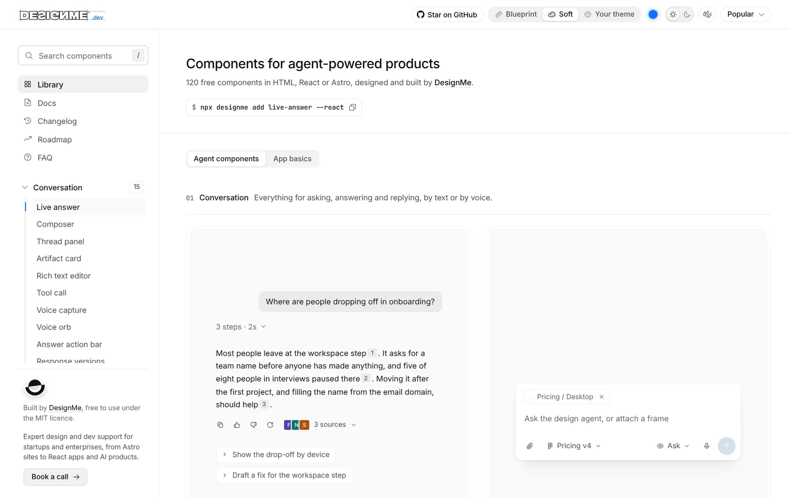

# designme.dev

Free, MIT-licensed UI components for products built around AI agents. 122 of them: 72 agent components (status pills,
reasoning trails, tool calls, permission gates, plan reviews, run summaries and more) and 50 app basics around them
(charts, dates, forms, tables).

Each one comes as plain HTML, CSS and JavaScript, as a typed React component, or as an Astro component. Every component
comes in two styles, Soft and Blueprint, with light and dark mode.

[Browse the library](https://designme.dev) · [Docs](https://designme.dev/docs) · [Changelog](https://designme.dev/#/changelog)

<picture>
  <source media="(prefers-color-scheme: dark)" srcset=".github/screenshot-dark.webp">
  
</picture>

## Install

The `designme` CLI copies each component's source into your project, so you own it. It needs Node 18 or later. Find a
component's install name on its page, or list them all:

```sh
npx designme list
```

### HTML, CSS and JavaScript

```sh
npx designme add status-pill thinking composer
```

Each component lands in its own folder in `./designme`, with its `.html`, `.css`, `.js` and a `demo.html` you can open
straight away. The shared core (`core/core.css` and `core/core.js`) is added once.

### React

```sh
npx designme add status-pill thinking composer --react
```

Typed `.tsx` components for Next.js, Vite and Astro islands. They need React 19. They land in `src/components/designme`
(or `components/designme` when there is no `src` folder). Add `--examples` for a `.example.tsx` beside each component that
replays its demo.

```tsx
import { StatusPill } from '@/components/designme/status-pill/StatusPill';

<StatusPill state="reading" label="Reading Figma frames" meta="2 of 4" />
```

### Astro

```sh
npx designme add tool-call --astro
```

`.astro` components with the same markup, CSS and script as the HTML version. They land in `src/components/designme`
(or `components/designme`), with the shared core in `core/`.

### shadcn CLI

Every component is also a shadcn registry item, in React and Astro, for a project set up for shadcn/ui:

```sh
npx shadcn@latest add https://designme.dev/r/shadcn/status-pill.json
npx shadcn@latest add https://designme.dev/r/shadcn/astro/status-pill.json
```

### CLI options

| Option | What it does |
| --- | --- |
| `--react` | React components instead of HTML, CSS and JavaScript |
| `--astro` | Astro components instead of HTML, CSS and JavaScript |
| `--theme-bridge` | Also add the theme bridge (see below). Works without component names too |
| `--examples` | With `--react`, an example beside each component |
| `--dir <path>` | Put the files somewhere else |
| `--force` | Replace files you already have |

## Styles and themes

Two attributes on `<html>` pick the look:

```html
<html>                     <!-- Blueprint, the default -->
<html data-style="soft">   <!-- Soft -->
<html data-theme="dark">   <!-- or "light"; without it, the components follow the device -->
```

Every CSS variable starts with `--dm-` (`--dm-accent`, `--dm-muted`), in HTML, React and Astro, so the components never
meet your page's own variables. In React every class and animation name starts with `dm-` too.

The theme bridge (`--theme-bridge`) is an opt-in CSS file that gives the components the colours and corners of a
shadcn/ui or Tailwind v4 theme. See [Theming](https://designme.dev/docs/theming) and
[Installation](https://designme.dev/docs/installation).

## Docs

- [Introduction](https://designme.dev/docs/introduction)
- [Installation](https://designme.dev/docs/installation)
- [Astro](https://designme.dev/docs/astro)
- [Theming](https://designme.dev/docs/theming)
- [Accessibility](https://designme.dev/docs/accessibility)
- [Using with AI](https://designme.dev/docs/using-with-ai)

Every component has a page at `https://designme.dev/components/<name>` with a live demo, install commands, React props
and code. Each page has a Markdown copy at the same address plus `.md`, and
[llms.txt](https://designme.dev/llms.txt) lists them all for AI tools.

## How this repository is built

The site is static and Cloudflare Pages serves this repository as it is. Some files are sources and the rest are built
from them.

| Sources (edit these) | Generated (don't edit by hand) |
| --- | --- |
| `soft-2/index.html`: every HTML component | `index.html`, `404.html`, `llms.txt`, `code-data.json` |
| `packages/react`: the React components (`.tsx`) | `r/`: the registries the CLI and shadcn read |
| `tools/pages/content/<id>.json`: each component's docs copy | `components/`, `docs/`, `sitemap.xml`, `_redirects` |
| `tools/site/*` and `tools/pages/*`: the build | `packages/astro/src`: the Astro components |
| `packages/designme`: the CLI | In `packages/react`: the CSS, `src/index.ts` and the files in `src/lib` marked "Generated" |

Build from `tools/site`:

```sh
npm install
npm run base      # once: writes site-main.html, the original page, from git history (needs a full clone)
npm run patches   # only when make-patches.py changed
npm run build     # index.html, the HTML registry in r/, llms.txt, 404.html
npm run react     # the React CSS and r/react
npm run astro     # packages/astro, r/astro, r/shadcn and the theme bridge
npm run pages     # the component and docs pages, and the sitemap
```

[CONTRIBUTING.md](CONTRIBUTING.md) has the details: what each step needs, local checks, and how to propose a component.

## Contributing

Bug reports, fixes and component ideas are welcome. Read [CONTRIBUTING.md](CONTRIBUTING.md) first, and the
[code of conduct](CODE_OF_CONDUCT.md). Report security issues privately, as [SECURITY.md](SECURITY.md) says.

## Licence

[MIT](LICENSE), by [DesignMe](https://designme.agency). Fonts, icons, flags, brand marks and sounds from other projects
keep their own licences, listed in [NOTICE.md](NOTICE.md).
